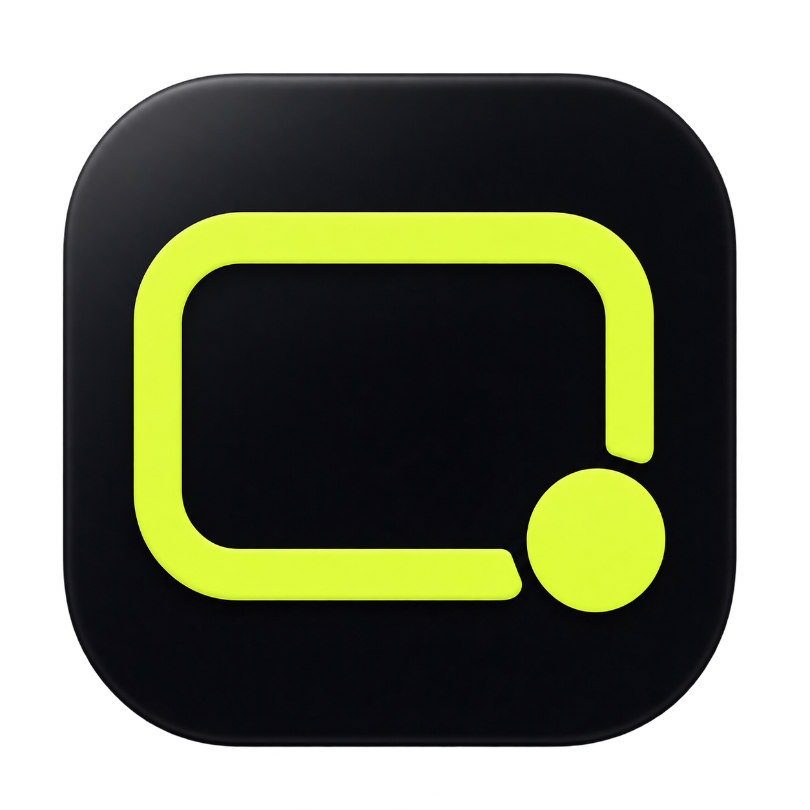

# FrameCraft app icon

Version 0.3.4 (build 8), November 6, 2026. Tracked in [SBSTN-105](https://linear.app/mnnsbstn/issue/SBSTN-105/eigenes-framecraft-app-icon-entwerfen-und-integrieren).



## Design and assets

A rounded screen frame and recording dot represent screen capture and composition. The user's chosen palette is near-black (#08090b base) with yellow-lime **#e5ff42** accents. Generated lighting introduces subtle tonal variation; these are palette references, not a claim that every pixel has the exact hex value. No Screen Studio artwork is used.

- [Master PNG](../Assets/AppIcon.png): 1254 × 1254 pixels, transparent outside the tile.
- [macOS ICNS](../Assets/AppIcon.icns): 16, 32, 128, 256 and 512 point representations at 1× and 2×, ten images in total, up to 1024 physical pixels.
- [Packaged app](../artifacts/FrameCraft-0.3.4-macos-arm64.zip).

## Reuse and packaging

Edit or replace the square master PNG, keeping at least 1024 pixels per side and transparency. Regenerate the standalone resource with `./script/build_icon.sh`. The normal `./script/build_and_run.sh --build` also generates it directly into the staged app's `Contents/Resources/AppIcon.icns`, sets `CFBundleIconFile`, and signs the completed bundle. Quit FrameCraft normally before rebuilding; the existing running-app guard remains active.

The existing bundle identifier, installed app path and persistent local signing identity are retained. No screen permission reset or keychain identity replacement was performed for this update.

## Verification

Build and shell syntax checks passed. The ICNS roundtrip contains all ten correctly sized representations. Installed and source icon hashes match. Strict signature validation and mutual previous/current designated-requirement checks passed; the extracted download also passes signature validation and retains executable permissions. The app launches, and its native About panel visibly shows the new icon and version 0.3.4 (8). The 128-pixel representation was also visually inspected.

This update changes assets and packaging only. Runtime Swift sources and tests are unchanged. The prior 29 passing tests and 347.910-second save/reopen/export acceptance remain the functional baseline; neither was rerun for the icon. The build reports existing capture/composition API warnings. See [structured checks](verification/app-icon-0.3.4.json) and [build output](verification/build-0.3.4.txt).

## Generation provenance

Created with the built-in imagegen tool, then recolored with an imagegen edit in response to the user's black/#e5ff42 request. The original generated screen-frame/recording-dot composition was retained; the earlier purple palette was discarded. The final PNG is preserved without retouching. Apple `sips` and `iconutil` create the packaging sizes only. Image generation is nondeterministic; the committed master is the reproducible packaging source.

Final edit prompt (`transparent_background: true`):

```text
Edit this FrameCraft macOS app icon. Preserve the exact composition, rounded-square silhouette, open lower-right screen frame, round recording dot, generous outer transparent margin and overall geometry. Change the palette only, with slightly more restrained materials: tile is deep matte BLACK / near-black charcoal (#08090b base), with subtle neutral black shading and a restrained soft edge bevel. BOTH the screen-frame symbol and recording dot use the user's exact accent color #e5ff42 as their dominant base tone (electric yellow-lime), with only subtle lighting variation. No violet, purple, coral, red, ivory or white symbols remain. No colored glow around the tile. Clear high-contrast premium macOS icon, legible at small sizes. Keep background outside the tile genuinely transparent; preserve alpha, no backdrop or checkerboard. No text, no extra details, no changes to geometry.
```
