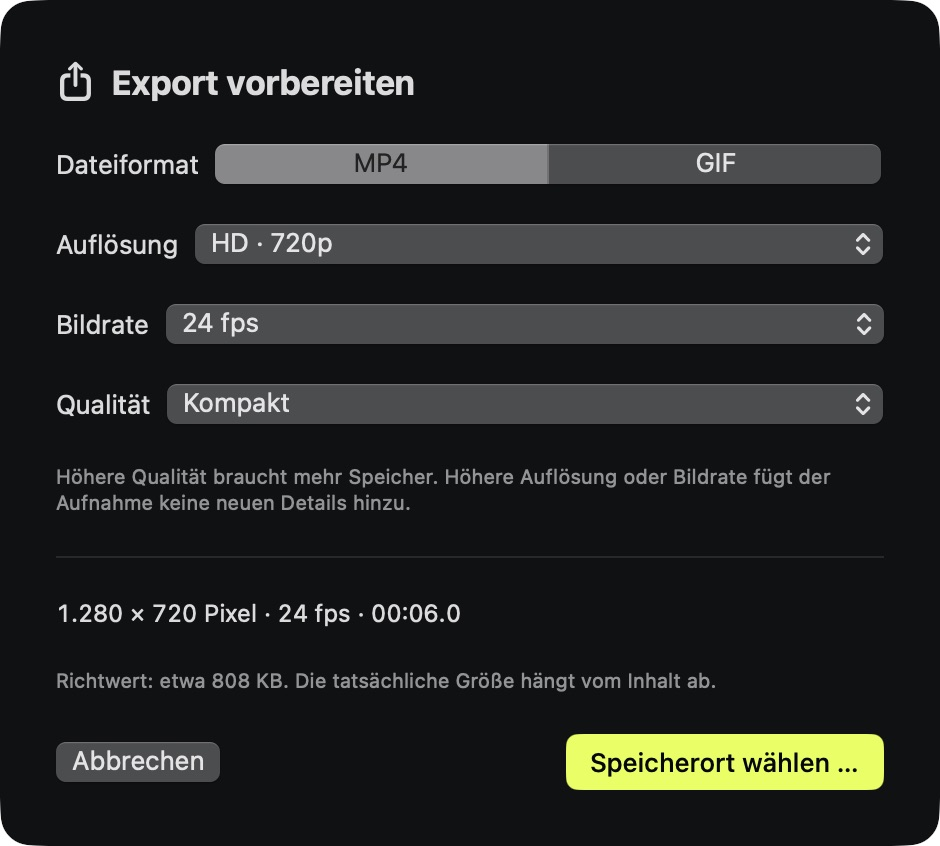
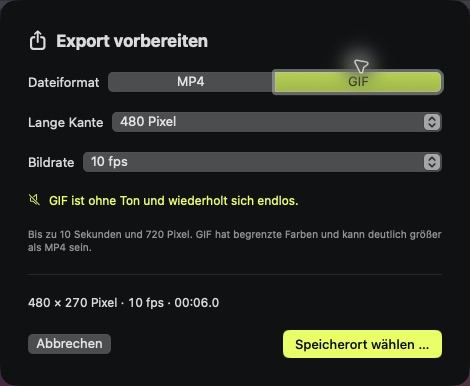

# Export options — 0.5.0

Choose **Video exportieren** to open the export settings, then **Speicherort wählen …** to choose a new destination. The editor pauses playback before opening the sheet. Export keeps the current trim, canvas, background, zooms, frame, cursor and mute setting.

| Format | Resolution | Frame rate | Quality / audio |
| --- | --- | --- | --- |
| MP4 (H.264) | HD, Full HD, 4K | 24, 30, 60 fps | Compact, Balanced, High; AAC audio when present and not muted |
| GIF | 480 or 720 pixel long edge | 10 or 20 fps | Silent, infinite loop; up to 10 seconds |

MP4 dimensions follow the canvas: HD is 1280×720 landscape, 720×1280 portrait or 720×720 square. Full HD scales these by 1.5; 4K scales them by 3. The dialog shows the actual dimensions. GIF dimensions preserve the canvas aspect ratio and round down to even pixels (for example, 720-pixel portrait GIF is 404×720).

The default is Full HD, 30 fps, High. Higher export resolution or frame rate does not create detail missing from the source. Quality controls the target video bitrate; the displayed file size is an estimate, including an audio allowance, not a guaranteed size. GIF has a limited palette and may be larger than MP4. For longer clips, trim to at most ten seconds or choose MP4.

Selections remain available during the current app session; they are not stored in project files. Cancelling the options or save dialog does not start an export. Existing files and the original source are protected. Export writes to a private temporary directory beside the destination and moves only a completed file into place. Explicit cancellation, parent-task cancellation and failures remove temporary media, including encoder sidecar files. The exporter can then be reused.

## Implementation

The shared composition accepts output dimensions and frame rate. Corner radius and shadow scale with the output canvas. MP4 uses AVAssetReader and AVAssetWriter with explicit H.264 settings; source timestamps are retained and the writer session starts at the trim boundary. Available audio tracks are mixed to stereo 48 kHz AAC at 192 kbps; muted exports omit the audio track. GIF uses the same composition through AVAssetImageGenerator and ImageIO with per-frame timing and an infinite-loop property. Encoding runs outside the UI actor.

The three quality targets use 0.04, 0.08 and 0.14 bits per pixel per frame, clamped to 0.5–80 Mbps. Defaults and supported values are centralized in `ExportSettings`. The project schema is unchanged.

Primary API references: [writer session timing](https://developer.apple.com/documentation/avfoundation/avassetwriter/startsession(atsourcetime:)), [writer output settings](https://developer.apple.com/documentation/avfoundation/avassetwriterinput/init(mediatype:outputsettings:)), and [ImageIO destinations](https://developer.apple.com/documentation/imageio/cgimagedestination).

## Automated validation

All 40 tests pass. New coverage checks:

- HD portrait at 24 fps and 4K landscape at 60 fps, with a nonzero trim start and decoded output frames.
- GIF dimensions, all ten frames of a one-second test, frame delays and infinite looping.
- Duration and settings limits, existing-file protection, active GIF cancellation, temporary cleanup and reuse.
- Two synthetic audio tracks mixed into a trimmed MP4, decodable audio, and no audio track when muted.
- Existing trim, cursor rendering, failure recovery, MP4 cancellation and parent cancellation tests continue to pass.

The synthetic fixture keeps its source audio asset alive while composing the media; this avoids a fixture preparation failure. Temporary encoder sidecars found by the regression tests are now contained in the export temporary directory.

These checks do not constitute live system-audio/microphone or multi-display acceptance. SBSTN-83 and SBSTN-84 remain separate open tasks.

## Installed application acceptance

Version 0.5.0 (build 11) was installed and launched at the existing app location with the same local signing identity. Strict verification passed for the installed app and the extracted archive; the build checked both old-to-new and new-to-old signing requirements. No privacy permission was reset.

The native settings sheet was inspected: HD / 24 fps / Compact updated the displayed dimensions and size estimate. Those values remained selected when reopening the sheet. Switching to GIF displayed the silent, infinite-loop and ten-second guidance, with the correct `.gif` save extension. Both native save flows completed and revealed the resulting files in Finder.

| UI export | Dimensions | Frames decoded | Duration | Size |
| --- | --- | --- | --- | --- |
| MP4, Compact, 24 fps | 1280×720 | 144 | 6 s | 371,010 bytes |
| GIF, 10 fps | 480×270 | 60 | 6 s | 755,109 bytes |

The existing saved timeline demo was independently exported through the same production service: its MP4 (333,774 bytes) and GIF (718,692 bytes) also decoded completely. These sizes are content-specific, not preset guarantees. Only original synthetic demo content was used; no live screen recording was needed for this release.

Evidence: [acceptance](verification/export-options-0.5.0.json), [UI media](verification/ui-export-media-0.5.0.json), [saved-project media](verification/export-media-0.5.0.json), [tests](verification/tests-0.5.0.txt), [build](verification/build-0.5.0.txt), [signature](verification/signature-0.5.0.txt). Original files are in `examples/FrameCraft-UI-Export-0.5.0.*` and `examples/FrameCraft-Exporttest-0.5.0.*`.

For repeatable media checks, compile `script/verify-export-media.swift` with `Sources/FrameCraft/Models/*.swift` using `swiftc -parse-as-library`, then pass an output directory and MP4/GIF paths. The full export harness is `script/verify-export-options.swift`; compile it with the models, `VideoRenderer`, `ExportService`, `MediaExportWorker` and `Support/StorageFailure`, then pass a `.framecraft` demo folder and an empty output directory. Existing output files are deliberately not overwritten.
