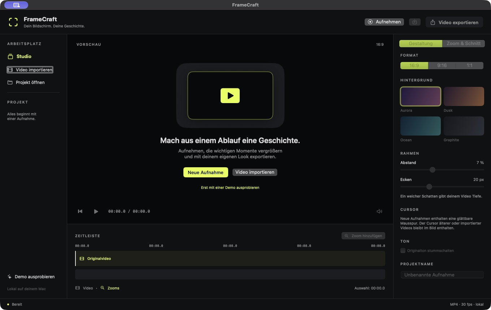
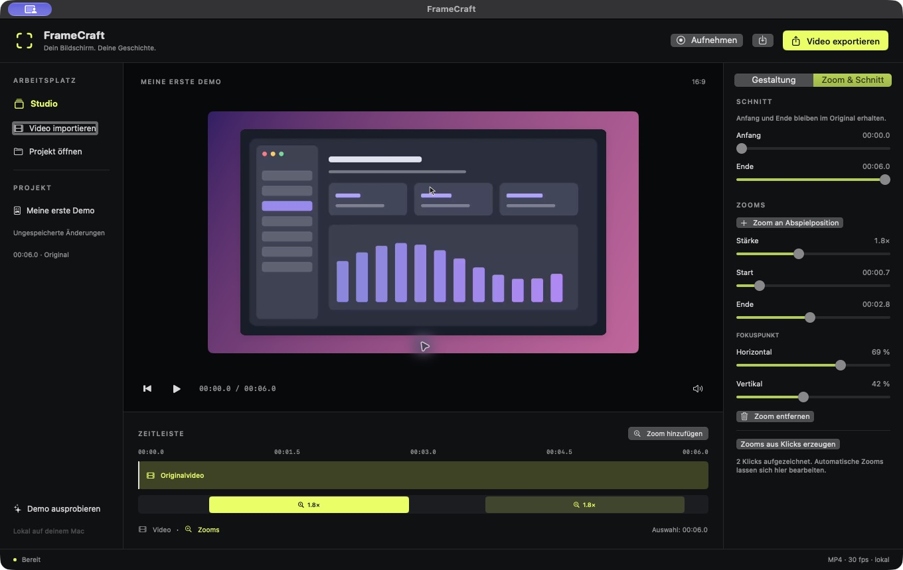
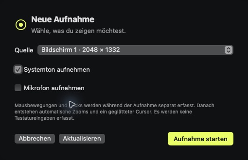

# Black and lime interface

FrameCraft 0.3.5 (build 9), November 6, 2026. [SBSTN-106](https://linear.app/mnnsbstn/issue/SBSTN-106/oberflache-an-schwarzes-icon-mit-akzent-e5ff42-anpassen).

Historical 0.3.5 design: the interface matched the then-lime app icon: near-black surfaces, lime primary actions and selection indicators, and neutral text. The requested fixed dark appearance applies to the main window, recording sheet and app-owned native panels, independently of the system's Light/Dark preference. It does not change the system-wide appearance.

Since 0.4.0 the app icon uses white symbols at the user’s request; this interface palette remains unchanged.

## Palette and behavior

| Role | sRGB color |
| --- | --- |
| Accent and primary button fill | `#e5ff42` |
| Preview canvas and text on accent | `#08090b` |
| Header, sidebar, inspector, timeline, recording sheet | `#101113` |
| Raised surfaces and disabled primary buttons | `#1b1d20` |

The shared [StudioTheme](../Sources/FrameCraft/Support/StudioTheme.swift) defines these colors. Primary actions have dark labels with explicit enabled, disabled, pressed, hover and focus styling. The calculated contrast of dark labels against the solid accent is 17.75:1; this is a specific color-pair check, not a complete accessibility certification. Standard secondary text and neutral native controls follow dark macOS appearance. Recording/stop and error indicators retain their semantic red.

The welcome illustration, demo action, studio label, ready indicator, sliders, segmented selections, selected background outline and video/zoom timeline use the shared accent. Selected zoom blocks use solid lime with dark labels; other zoom blocks have a subdued fill and lime labels. The existing app layout, German labels and action handlers remain in place.

Project background swatches and the actual video retain their original colors. Those colors are editable media content, independent of the app theme. Capture, rendering, project models, persistence and store implementations are unchanged.

## Verification and distribution

- Release build and launch passed. Existing compiler warnings concern capture/composition APIs.
- All 29 existing tests passed again, including export and persistence failure paths. No new tests were added for palette constants.
- Inspected welcome and disabled export states, recording dialog and enabled start button, demo preview, enabled export action, zoom selection and inspector updates, appearance controls and background selection outline.
- The recording source list loaded after the update without a permission reset or new prompt. The dialog was cancelled; no live recording was made for this visual change.
- Strict signing and mutual designated-requirement checks against version 0.3.4 passed. Bundle ID, signing identity and installed app path remain stable.
- The updated ZIP was extracted and its signature and executable permissions verified. Screenshots contain only FrameCraft and its generated demo.

Evidence: [structured checks](verification/theme-0.3.5.json), [test log](verification/tests-0.3.5.txt), [build output](verification/build-0.3.5.txt). The prior [five-minute live recording acceptance](Five-Minute-Test.md) remains available; it was not repeated for this theme update.

[Download 0.3.5 for Apple Silicon](../artifacts/FrameCraft-0.3.5-macos-arm64.zip). Future interface colors should use StudioTheme; primary actions use `studioPrimaryAction()`. Rebuild with the existing `./script/build_and_run.sh --build` after quitting the app normally. Keep the local signing identity to retain update continuity.
