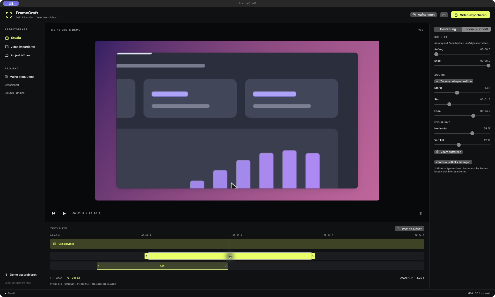

# Editing zoom intervals in the timeline

FrameCraft 0.4.0 (build 10), November 6, 2026. [SBSTN-86](https://linear.app/mnnsbstn/issue/SBSTN-86/zoomintervalle-direkt-in-der-zeitleiste-bearbeiten).

Each zoom has its own scrollable row. Overlapping intervals remain independently selectable and editable. The video ruler retains the original clip's time coordinates.

## Controls

- Drag the left or right chevron to change the start or end.
- Drag the middle of a block to move the whole interval without changing its length.
- Click a handle or the middle to select and focus it. Left/Right moves the focused boundary or interval by 0.1 seconds; Shift+Left/Right uses 0.5 seconds. Tab moves between controls. Accessibility increment/decrement actions are also available.
- The selected start/end values appear below the timeline, in control accessibility values and tooltips. The inspector updates with the selection. Editing pauses playback and seeks to the boundary or interval midpoint.
- Scroll vertically to reach additional intervals. Each row is stable during a drag, including when intervals begin to overlap.

Timing is clamped to the full original video, from zero to its duration. Moving preserves interval length; resizing keeps at least 0.1 seconds, or preserves the shorter minimum of an already-short legacy interval. Trimming remains nondestructive and independent. This does not prevent intervals outside the current trimmed range.

Very short intervals use a minimum 64-point grab area so the three targets remain usable. A thin line below the grab area shows the exact time span; the displayed start/end values remain authoritative. The grab area is kept within the timeline bounds.

Actual timing changes mark the interval as manual. Regenerating automatic click zooms preserves that manual interval and can create overlapping automatic intervals; existing manual camera priority remains unchanged. A click or clamped no-op does not turn an automatic interval into a manual one. The project schema is unchanged.

## Implementation and verification

[ZoomTiming](../Sources/FrameCraft/Models/ZoomTiming.swift) handles finite inputs, clamping, minimum length and manual status. Drag deltas are applied to the gesture's original snapshot, preventing cumulative drift. [ZoomTimelineItem](../Sources/FrameCraft/Views/ZoomTimelineItem.swift) connects pointer, keyboard and accessibility input to those rules. Selection and mutation explicitly check the enabled state, including during export/recording/loading.

35 tests passed, including six new timing tests: movement boundaries and preserved focus/scale, edge resizing, invalid/no-op inputs, snapshot-relative deltas, short legacy intervals, and manual overlap preservation through regeneration/serialization.

The UI acceptance used the generated six-second demo:

1. Drag the first start from 0.75 to approximately 1.14 seconds.
2. Press Right (+0.1 seconds), then Shift+Left (−0.5 seconds).
3. Drag the end and move the whole interval. The final manual interval is 1.5135423400–4.2462508080 seconds.
4. Regenerate automatic zooms: the manual interval remains, with two automatic intervals in separate rows.
5. Save and reopen the project; all three intervals and manual timing remain.
6. Export the reopened project: 1920 × 1080, 6 seconds, nominal 30 fps, no audio. All 180 decoded video frames complete without a reader error; the middle sampled frame was visually inspected. The compressed reader reports 184 samples; that sample count is not a decoded-frame count.

After the UI/export pass, explicit enabled-state guards were added to the callbacks. All 35 tests, release build and installed startup were repeated. The media was not regenerated because rendering and timing algorithms were unchanged. No new live screen/audio recording was performed.

Evidence: [checks](verification/timeline-0.4.0.json), [test log](verification/tests-0.4.0.txt), [build](verification/build-0.4.0.txt), [media metadata](verification/timeline-0.4.0-media.json), [complete decode](verification/timeline-0.4.0-decode.txt), [saved project](../examples/FrameCraft-Zeitleistentest-0.4.0.framecraft), [MP4](../examples/FrameCraft-Zeitleistentest-0.4.0.mp4).

## Release scope

Version 0.4.0 also changes the [app icon to white on black](App-Icon.md), per the user's concurrent request (SBSTN-107). The interface keeps its #e5ff42 accent. Stable local signing, mutual requirements against 0.3.5, installed icon, and the extracted app archive were verified. Download [the Apple Silicon build](../artifacts/FrameCraft-0.4.0-macos-arm64.zip).

Audio/microphone and full-display/multi-monitor acceptance remain separate open Linear tasks. Undo, magnetic snapping, horizontal timeline zoom and multi-clip editing are not included in this interval-editing release.
